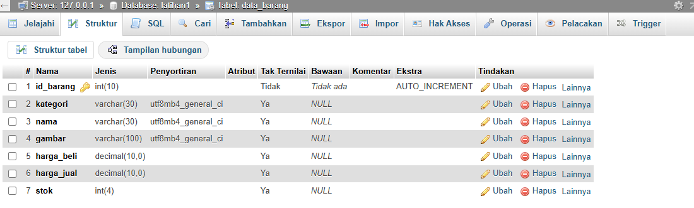
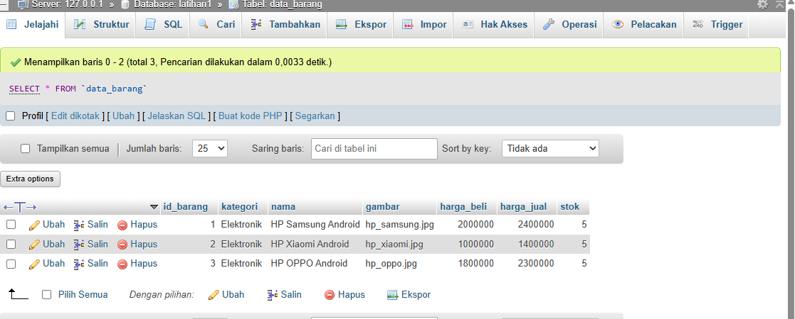
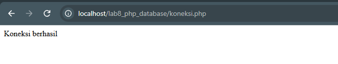
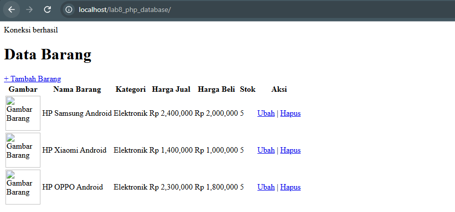
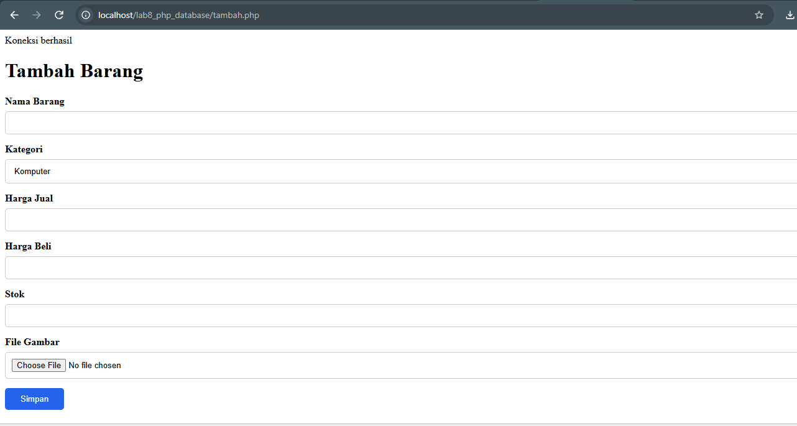
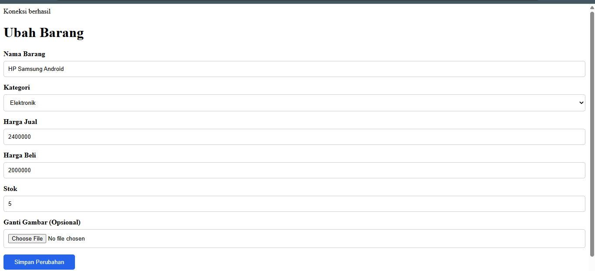
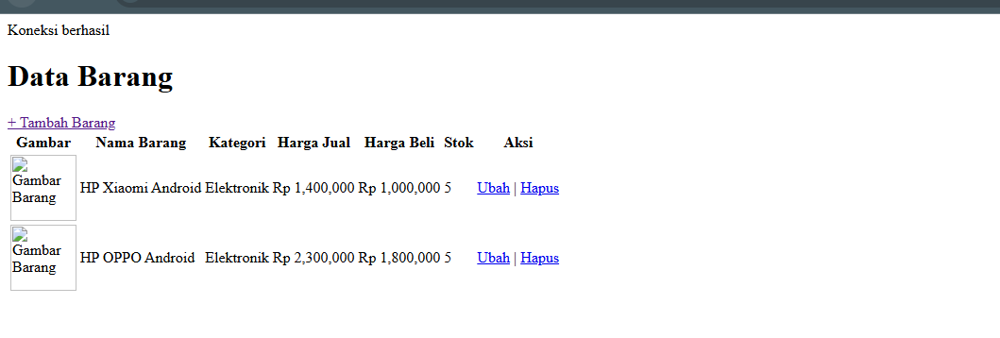

# Praktikum 8 – PHP dan Database MySQL

## 1. Tujuan Praktikum

Melalui praktikum ini, mahasiswa diharapkan mampu:
- Membuat database dan tabel menggunakan phpMyAdmin.
- Menghubungkan PHP dengan database MySQL.
- Menampilkan data barang dari database.
- Menambahkan data barang baru.
- Mengubah data barang yang sudah tersimpan.
- Menghapus data barang dari database.

## 2. Langkah-Langkah Praktikum

### A. Menjalankan XAMPP
1. Buka aplikasi XAMPP.
2. Aktifkan Apache dan MySQL.
3. Buka browser dan akses `http://localhost/phpmyadmin/`.

### B. Membuat Database
1. Buka phpMyAdmin.
2. Buat database dengan nama `latihan1`.
3. Buat tabel dengan nama `data_barang`.
4. Tambahkan kolom sesuai struktur tabel pada modul praktikum.
5. Masukkan beberapa data barang sebagai data awal.

### C. Membuat Koneksi Database
1. Buat folder `lab8_php_database` di dalam folder `htdocs`.
2. Buka folder tersebut menggunakan Visual Studio Code.
3. Buat file `koneksi.php`.
4. Masukkan kode koneksi PHP ke database `latihan1`.
5. Jalankan file melalui browser untuk memastikan koneksi berhasil.

### D. Menampilkan Data Barang
1. Buat file `index.php`.
2. Hubungkan file dengan `koneksi.php`.
3. Gunakan perintah SELECT untuk mengambil data dari tabel `data_barang`.
4. Tampilkan data barang dalam bentuk tabel pada browser.

### E. Menambahkan Data Barang
1. Buat file `tambah.php`.
2. Buat form untuk memasukkan kategori, nama barang, gambar, harga beli, harga jual, dan stok.
3. Gunakan perintah INSERT untuk menyimpan data.
4. Periksa apakah data baru berhasil ditampilkan pada halaman utama.

### F. Mengubah Data Barang
1. Buat file `ubah.php`.
2. Tambahkan link Ubah pada setiap baris data barang.
3. Tampilkan data barang berdasarkan ID yang dipilih.
4. Ubah informasi barang melalui form.
5. Simpan perubahan dan periksa hasilnya.

### G. Menghapus Data Barang
1. Buat file `hapus.php`.
2. Tambahkan link Hapus pada setiap baris data barang.
3. Gunakan ID barang untuk menentukan data yang akan dihapus.
4. Periksa apakah data berhasil dihapus dari tabel.

## 3. Screenshot Hasil Praktikum

### A. Tampilan Database di phpMyAdmin
**Bukti:** Screenshot database `latihan1` dan tabel `data_barang`.

### B. Koneksi PHP dengan MySQL
**Bukti:** Screenshot hasil pengujian koneksi database.

### C. Tampilan Data Barang
**Bukti:** Screenshot halaman utama yang menampilkan daftar barang.

### D. Form Tambah Barang
**Bukti:** Screenshot form untuk menambahkan barang baru.

### E. Hasil Ubah Barang
**Bukti:** Screenshot form ubah barang dan hasil setelah perubahan disimpan.

### F. Hasil Hapus Barang
**Bukti:** Screenshot halaman setelah data barang berhasil dihapus.

## 4. Kesimpulan

Berdasarkan praktikum yang telah dilakukan, dapat disimpulkan bahwa PHP dapat dihubungkan dengan database MySQL untuk mengelola data. Operasi CRUD berhasil diterapkan sehingga pengguna dapat menampilkan, menambahkan, mengubah, dan menghapus data barang melalui halaman web.